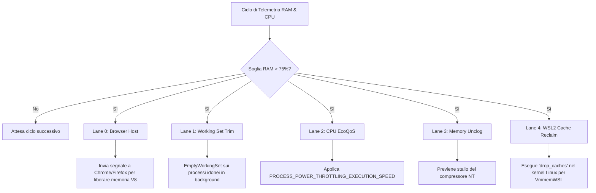
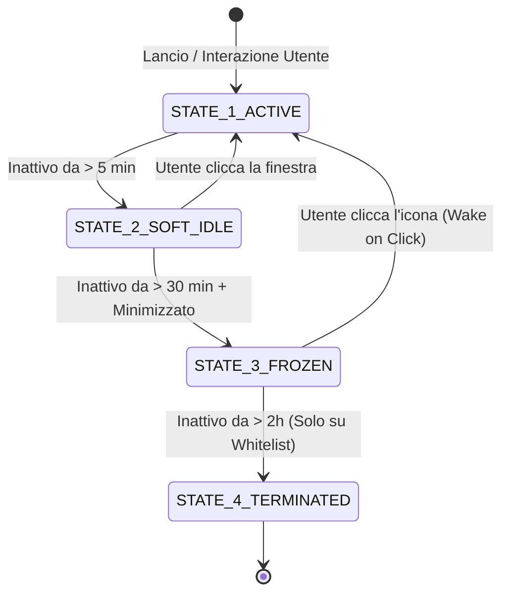

# PROGETTO AVANZATO: ControlRAM Lifecycle & Smart Hibernation Engine (V2)
> **Dossier Tecnico Completo, Mappatura del Progetto Esistente e Blueprint Architetturale per la Nuova Versione Separata.**
> *Documento creato come base di sviluppo autonoma, pronto per modifiche, fork e implementazione del sottosistema di congelamento/chiusura intelligente dei processi.*

---

## INDICE DEI CONTENUTI
1. [Visione del Progetto Avanzato e Differenziazione](#1-visione-del-progetto-avanzato-e-differenziazione)
2. [Mappa Completa dell'Architettura Attuale (ControlRAM v0.5.0 R22)](#2-mappa-completa-dellarchitettura-attuale-controlram-v050-r22)
   - 2.1 File e Struttura della Repository
   - 2.2 Il Motore Decisionale a 5 Lane
   - 2.3 API C++ Win32 Native (`ame-resource-api.dll`)
   - 2.4 Interfaccia Grafica e Runner Batch (`AUTOMATICO.cmd`, `hub.ps1`)
   - 2.5 Integrazione WSL2 / Linux Kernel Cache (`drop_caches`)
3. [Specifiche del Nuovo Sottosistema: Process Lifecycle & Smart Hibernation (PLSHE)](#3-specifiche-del-nuovo-sottosistema-process-lifecycle--smart-hibernation-plshe)
   - 3.1 Gli Stati del Processo (Macchina a Stati Finiti)
   - 3.2 Modalità Sospensione / Freeze (`NtSuspendProcess` + `NtResumeProcess`)
   - 3.3 Gestione Schede Browser (Chromium Tab Discarding)
   - 3.4 Criteri di Chiusura Reale Controllata (Safe Termination)
4. [Telemetria e Logiche di Sicurezza Anti-Crash (Safety Matrix)](#4-telemetria-e-logiche-di-sicurezza-anti-crash-safety-matrix)
   - 4.1 Rilevamento Audio Attivo (`IAudioSessionManager2`)
   - 4.2 Monitoraggio I/O Disco e Throughput di Rete
   - 4.3 Finestre Ridotte a Icona e Rilevamento Idle Utente
   - 4.4 Risveglio Istantaneo tramite Hook WinEvent (`EVENT_SYSTEM_FOREGROUND`)
5. [Blueprint del Codice e Strutture Dati](#5-blueprint-del-codice-e-strutture-dati)
   - 5.1 Firma Funzioni Native NT e Hook C++
   - 5.2 Algoritmo Decisionale Completo (Pseudocodice / Implementazione)
   - 5.3 Schema di Configurazione (`advanced-policy.json`)
6. [Guida per la Creazione del Ramo / Progetto Separato](#6-guida-per-la-creazione-del-ramo--progetto-separato)

---

## 1. VISIONE DEL PROGETTO AVANZATO E DIFFERENZIAZIONE

### 1.1 Perché un Progetto Separato?
ControlRAM (v0.5.0 R22) ha raggiunto uno standard di stabilità ottimale per l'uso quotidiano:
* Riduce la memoria fisica del **20% – 30%**.
* Non tocca la vita dei processi (non li arresta né li sospende).
* Interviene esclusivamente tramite compattazione (*Working Set Trimming*) e assegnazione della priorità CPU *EcoQoS* (Efficiency Mode).

Il **Progetto Avanzato** nasce per spingersi oltre questo limite fisiologico, affrontando direttamente la causa primaria della saturazione della RAM: **i processi orfani o dimenticati in background**. 
Mantenere questa evoluzione come progetto separato garantisce:
1. **Nessun rischio per la versione base**: la versione stabile rimane intatta e funzionante.
2. **Libertà di sperimentazione estrema**: possibilità di testare sospensioni del kernel NT, API non documentate e chiusure automatiche senza timore di causare blocchi nel lavoro giornaliero.

---

## 2. MAPPA COMPLETA DELL'ARCHITETTURA ATTUALE (ControlRAM v0.5.0 R22)

### 2.1 File e Struttura della Repository

```
AdvancedMemoryEngine-v0.5.0/
│
├── AUTOMATICO.cmd                 <-- Avvia il sistema con monitoraggio e compattazione in background
├── STATO_AUTOMATICO.cmd           <-- Apre la dashboard di stato e telemetria in tempo reale
├── README.md                      <-- Documentazione principale (in lingua Inglese per GitHub)
├── README_IT.md                   <-- Documentazione completa in Italiano
├── .gitignore                     <-- Esclude file intermedi (.obj, .pdb), log e report
│
└── engine/
    ├── avvia.ps1                  <-- Script bootstrap del motore
    ├── hub.ps1                    <-- Interfaccia grafica WinForms (Dashboard)
    ├── agent.ps1                  <-- Loop di monitoraggio e decision maker
    ├── agent-runtime.ps1          <-- Gestione del ciclo di vita dell'agente di sfondo
    ├── agent-state.ps1            <-- Tracciamento stato processi e memoria
    ├── process-reduction-api.ps1  <-- Bridge PowerShell per chiamate di riduzione memoria
    ├── windows-model.ps1          <-- Modello dati WMI/CIM per metriche di sistema
    │
    ├── src/                       <-- SORGENTI C++ NATIVI E C#
    │   ├── main.cpp               <-- Entry point eseguibile CLI (ame.exe)
    │   ├── resource_api.cpp       <-- Implementazione C++ delle API di memoria (ame-resource-api.dll)
    │   ├── policy.hpp             <-- Regole di idoneità processi, liste esclusioni e whitelist
    │   ├── priority_lease.hpp     <-- Gestione priorità CPU ed EcoQoS (Power Throttling)
    │   ├── recover_controller.hpp <-- Monitoraggio soglie critiche di memoria e trigger di recupero
    │   ├── resource_analysis.hpp  <-- Algoritmi di calcolo risparmio RAM e Working Set
    │   ├── hub-runtime.cs         <-- Controller C# per la GUI del pannello
    │   └── resource-api-client.cs <-- Wrapper client C# per invocare la DLL nativa
    │
    ├── build/                     <-- BINARI PRECOMPILATI (x64 Release)
    │   ├── ame.exe                <-- CLI nativo autonomo per ottimizzazione istantanea
    │   ├── ame-resource-api.dll   <-- DLL core Win32 C++20
    │   └── chrome-native-host.json<-- Manifest per estensioni browser
    │
    └── browser/                   <-- ESTENSIONI BROWSER (Integrazione cooperativa)
        ├── chrome/                <-- Manifest v3, background.js, popup
        └── firefox/               <-- WebExtension Firefox
```

### 2.2 Il Motore Decisionale a 5 Lane

Il sistema attuale interviene su 5 corsie parallele:



### 2.3 API C++ Win32 Native Utilizzate

Le operazioni a basso livello sono racchiuse in [`engine/src/resource_api.cpp`](file:///D:/.A2/GEMNI-V2/AdvancedMemoryEngine-v0.5.0/engine/src/resource_api.cpp):
* **Compattazione Memoria**: 
  * `SetProcessWorkingSetSizeEx(hProcess, (SIZE_T)-1, (SIZE_T)-1, QUOTA_LIMITS_HARDWS_MIN_ENABLE)`
  * `EmptyWorkingSet(hProcess)` (tramite `psapi.dll`)
* **Abbassamento Priorità CPU (EcoQoS)**:
  * `SetProcessInformation(hProcess, ProcessPowerThrottling, &throttling, sizeof(throttling))`
  * Flag: `PROCESS_POWER_THROTTLING_EXECUTION_SPEED` (forza i thread su Efficient-cores su architetture Intel 12th+ Gen e riduce la frequenza di clock).
* **Filtri di Protezione**:
  * Esclusione categorica di processi critici: `csrss.exe`, `lsass.exe`, `smss.exe`, `services.exe`, `dwm.exe`, `explorer.exe`.
  * Protezione del processo in foreground attivo (`GetForegroundWindow` -> `GetWindowThreadProcessId`).

---

## 3. SPECIFICHE DEL NUOVO SOTTOSISTEMA: PROCESS LIFECYCLE & SMART HIBERNATION (PLSHE)

Questa è l'architettura inedita da implementare nel nuovo progetto.

### 3.1 Macchina a Stati Finiti del Processo

Ogni processo tracciato nel sistema passerà attraverso 5 stati sequenziali in base alla telemetria:



#### Dettaglio degli Stati:
1. **STATE 1: ACTIVE (Foreground / Uso Attivo)**
   * **Stato:** La finestra ha il focus dell'utente o ha ricevuto input da meno di 5 minuti.
   * **Azione:** Priorità normale/alta. Nessun trimming. Zero latenza garantita.
2. **STATE 2: SOFT IDLE (Background Breve)**
   * **Stato:** Inattivo tra 5 e 30 minuti.
   * **Azione:** Intervento standard ControlRAM V1 (Trimming del Working Set + EcoQoS CPU). Il processo continua a girare ma occupa meno RAM fisica.
3. **STATE 3: FROZEN / DEEP HIBERNATION (Ibernazione Selettiva - NUOVO)**
   * **Stato:** Finestra ridotta a icona (`IsIconic`) o coperta, nessun input da oltre 30 minuti, nessun audio o I/O disco attivo.
   * **Azione:** Invocazione di `NtSuspendProcess(hProcess)`. Tutti i thread vengono messi in pausa.
   * Subito dopo la sospensione, viene forzato `EmptyWorkingSet`: poiché i thread non possono riallocare memoria, **l'intera impronta RAM del processo scende a pochissimi megabyte**.
   * **Sicurezza:** Nessun dato perso. Lo stato dell'applicazione è congelato nella memoria virtuale.
4. **STATE 4: TERMINATED (Chiusura Assistita - NUOVO)**
   * **Stato:** Inattivo da oltre 2 ore.
   * **Vincolo assoluto:** Si applica **SOLO ED ESCLUSIVAMENTE** a processi inseriti in una lista esplicita di applicazioni sacrificabili (`whitelist_killable`).
   * **Metodo:** Invio di `WM_CLOSE` (chiusura gentile). Se non risponde entro 5 secondi, invio di `TerminateProcess`.

---

## 4. TELEMETRIA E LOGICHE DI SICUREZZA ANTI-CRASH (SAFETY MATRIX)

Prima di effettuare qualsiasi transizione a `STATE_3_FROZEN` o `STATE_4_TERMINATED`, il modulo deve validare la seguente matrice di sicurezza:

```
+-------------------------------------------------------------------------+
|                  CONTROLLI BLOCCANTI (SAFETY GATES)                     |
+-------------------------------------------------------------------------+
| 1. AUDIO ATTIVO?       --> Controlla WASAPI (IAudioSessionManager2)     |
|                            Se emette audio -> NON CONGELARE (es. Spotify)|
+-------------------------------------------------------------------------+
| 2. I/O DISCO ATTIVO?   --> Controlla GetProcessIoCounters (WriteBytes/s)|
|                            Se > 50 KB/s -> NON CONGELARE (es. Download) |
+-------------------------------------------------------------------------+
| 3. USO CPU RESIDUO?    --> Se CPU > 2.0% -> Sta elaborando dati         |
|                            NON CONGELARE (es. Rendering, Compilazione)  |
+-------------------------------------------------------------------------+
| 4. STATO FINESTRA?     --> La finestra deve essere IsIconic (ridotta)   |
|                            oppure non visibile all'utente.              |
+-------------------------------------------------------------------------+
```

### 4.1 Ripristino Istantaneo (Wake on Click)
Per evitare che l'utente percepisca il processo come bloccato o "crashato", il modulo deve agganciare un **WinEventHook**:

```cpp
// Registrazione dell'hook per rilevare quando l'utente clicca una finestra
HWINEVENTHOOK hHook = SetWinEventHook(
    EVENT_SYSTEM_FOREGROUND, EVENT_SYSTEM_FOREGROUND,
    NULL, WinEventProcCallback, 0, 0, WINEVENT_OUTOFCONTEXT
);
```

Non appena l'utente clicca sulla finestra congelata nella barra delle applicazioni:
1. L'evento `EVENT_SYSTEM_FOREGROUND` scatta in meno di **1 millisecondo**.
2. Il modulo recupera il PID associato alla finestra.
3. Se il processo era in `STATE_3_FROZEN`, invoca immediatamente `NtResumeProcess(hProcess)`.
4. I thread riprendono all'istante: l'utente vede la finestra aprirsi senza alcun errore o ritardo percepibile.

---

## 5. BLUEPRINT DEL CODICE E STRUTTURE DATI

### 5.1 Firme Funzioni Native NT (C++)

Le funzioni di congelamento/scongelamento atomico risiedono in `ntdll.dll`:

```cpp
#include <windows.h>
#include <iostream>

// Definizione dei puntatori alle funzioni native NT
typedef LONG(NTAPI* pfnNtSuspendProcess)(HANDLE ProcessHandle);
typedef LONG(NTAPI* pfnNtResumeProcess)(HANDLE ProcessHandle);

class ProcessFreezeController {
private:
    pfnNtSuspendProcess NtSuspendProcess;
    pfnNtResumeProcess  NtResumeProcess;

public:
    ProcessFreezeController() {
        HMODULE hNtDll = GetModuleHandleW(L"ntdll.dll");
        NtSuspendProcess = (pfnNtSuspendProcess)GetProcAddress(hNtDll, "NtSuspendProcess");
        NtResumeProcess  = (pfnNtResumeProcess)GetProcAddress(hNtDll, "NtResumeProcess");
    }

    bool FreezeProcess(DWORD pid) {
        HANDLE hProcess = OpenProcess(PROCESS_SUSPEND_RESUME | PROCESS_SET_QUOTA, FALSE, pid);
        if (!hProcess) return false;

        // 1. Sospende tutti i thread del processo
        LONG status = NtSuspendProcess(hProcess);
        if (status == 0) {
            // 2. Svuota istantaneamente il Working Set (la memoria va nel pagefile/compressione)
            SetProcessWorkingSetSizeEx(hProcess, (SIZE_T)-1, (SIZE_T)-1, QUOTA_LIMITS_HARDWS_MIN_ENABLE);
            CloseHandle(hProcess);
            return true;
        }

        CloseHandle(hProcess);
        return false;
    }

    bool ThawProcess(DWORD pid) {
        HANDLE hProcess = OpenProcess(PROCESS_SUSPEND_RESUME, FALSE, pid);
        if (!hProcess) return false;

        // Risveglia istantaneamente tutti i thread
        LONG status = NtResumeProcess(hProcess);
        CloseHandle(hProcess);
        return (status == 0);
    }
};
```

### 5.2 Rilevamento Audio Attivo (WASAPI in C++)

```cpp
#include <mmdeviceapi.h>
#include <audiopolicy.h>

bool IsProcessPlayingAudio(DWORD targetPid) {
    HRESULT hr;
    IMMDeviceEnumerator* pEnumerator = NULL;
    IMMDevice* pDevice = NULL;
    IAudioSessionManager2* pSessionManager = NULL;
    IAudioSessionEnumerator* pSessionList = NULL;
    bool isPlaying = false;

    CoInitialize(NULL);
    hr = CoCreateInstance(__uuidof(MMDeviceEnumerator), NULL, CLSCTX_ALL, 
                          __uuidof(IMMDeviceEnumerator), (void**)&pEnumerator);
    if (FAILED(hr)) return false;

    hr = pEnumerator->GetDefaultAudioEndpoint(eRender, eConsole, &pDevice);
    if (SUCCEEDED(hr)) {
        hr = pDevice->Activate(__uuidof(IAudioSessionManager2), CLSCTX_ALL, NULL, (void**)&pSessionManager);
        if (SUCCEEDED(hr)) {
            hr = pSessionManager->GetSessionEnumerator(&pSessionList);
            if (SUCCEEDED(hr)) {
                int sessionCount = 0;
                pSessionList->GetCount(&sessionCount);
                for (int i = 0; i < sessionCount; i++) {
                    IAudioSessionControl* pSession = NULL;
                    IAudioSessionControl2* pSession2 = NULL;
                    if (SUCCEEDED(pSessionList->GetSession(i, &pSession))) {
                        if (SUCCEEDED(pSession->QueryInterface(__uuidof(IAudioSessionControl2), (void**)&pSession2))) {
                            DWORD pid = 0;
                            pSession2->GetProcessId(&pid);
                            if (pid == targetPid) {
                                AudioSessionState state;
                                pSession2->GetState(&state);
                                if (state == AudioSessionStateActive) {
                                    isPlaying = true;
                                }
                            }
                            pSession2->Release();
                        }
                        pSession->Release();
                    }
                    if (isPlaying) break;
                }
                pSessionList->Release();
            }
            pSessionManager->Release();
        }
        pDevice->Release();
    }
    pEnumerator->Release();
    return isPlaying;
}
```

### 5.3 Schema File di Configurazione (`advanced-policy.json`)

```json
{
  "version": "2.0.0-experimental",
  "engine_mode": "Hybrid_Lifecycle_Suspend",
  "thresholds": {
    "ram_pressure_trigger_pct": 80.0,
    "idle_time_soft_minutes": 10,
    "idle_time_freeze_minutes": 30,
    "idle_time_kill_hours": 2,
    "max_disk_io_kb_sec": 50,
    "max_cpu_percent_allow_freeze": 1.5
  },
  "features": {
    "enable_process_freeze": true,
    "enable_tab_discarding": true,
    "enable_safe_termination": false,
    "wake_on_focus_hook": true
  },
  "whitelist_never_freeze": [
    "dwm.exe",
    "explorer.exe",
    "code.exe",
    "Antigravity.exe",
    "powershell.exe",
    "cmd.exe",
    "sqlservr.exe",
    "postgres.exe"
  ],
  "whitelist_killable_on_long_idle": [
    "EpicGamesLauncher.exe",
    "Battle.net.exe",
    "Spotify.exe",
    "Discord.exe",
    "AcroRd32.exe"
  ]
}
```

---

## 6. GUIDA PER LA CREAZIONE DEL RAMO / PROGETTO SEPARATO

Quando deciderai di sviluppare questa versione, segui questa procedura consigliata per mantenere la totale separazione:

### Passo 1: Creazione della nuova cartella di lavoro
Duplicare l'albero di progetto in una cartella parallela, ad esempio:
`D:\.A2\GEMNI-V2\ControlRAM-V2-LifecycleEngine\`

### Passo 2: Nuovo Nome e Brand del Modulo
* Modificare l'header in `engine/VERSION.txt`: `2.0.0-EXPERIMENTAL-LIFECYCLE`.
* Introdurre il file C++ dedicato: `engine/src/process_lifecycle.hpp`.

### Passo 3: Compilazione Autonoma
Compilare la nuova DLL senza toccare quella di ControlRAM v0.5.0:
```powershell
cl.exe /O2 /std:c++20 /LD engine/src/resource_api.cpp /Fe:engine/build/controlram-v2-api.dll
```

### Passo 4: Test Incrementali (Zero Rischio)
1. **Fase 1 (Sola Telemetria):** Eseguire il monitor senza sospendere nulla, verificando che il rilevamento audio, I/O e idle minuti sia corretto al 100%.
2. **Fase 2 (Sospensione Manuale):** Testare `NtSuspendProcess` e `NtResumeProcess` su una sola app di prova (es. `notepad.exe` o `calc.exe`) per verificare il risveglio immediato tramite `EVENT_SYSTEM_FOREGROUND`.
3. **Fase 3 (Tab Discarding):** Integrare lo scarto schede browser prima di applicare qualsiasi sospensione di sistema.
